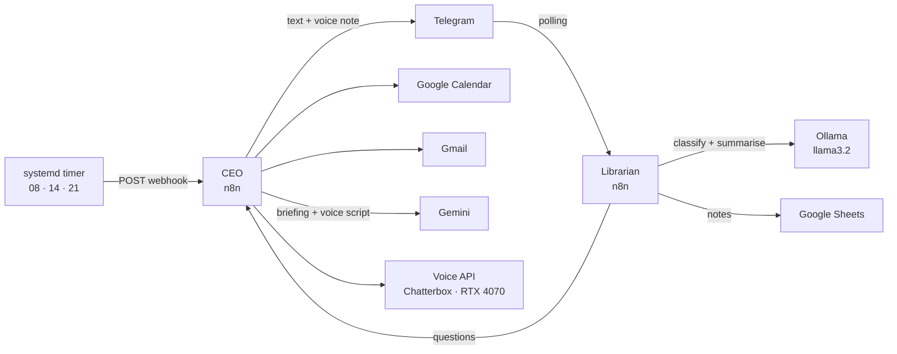
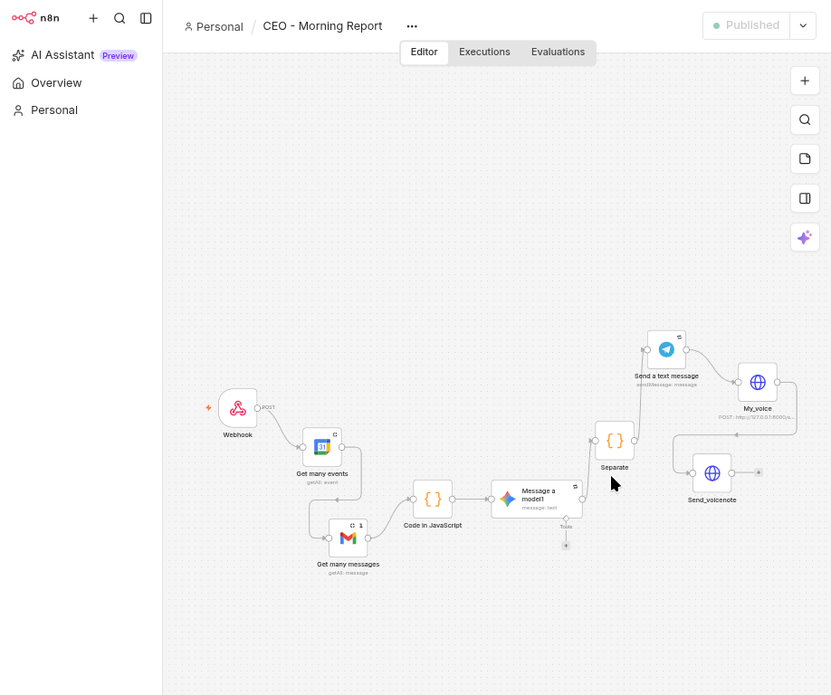
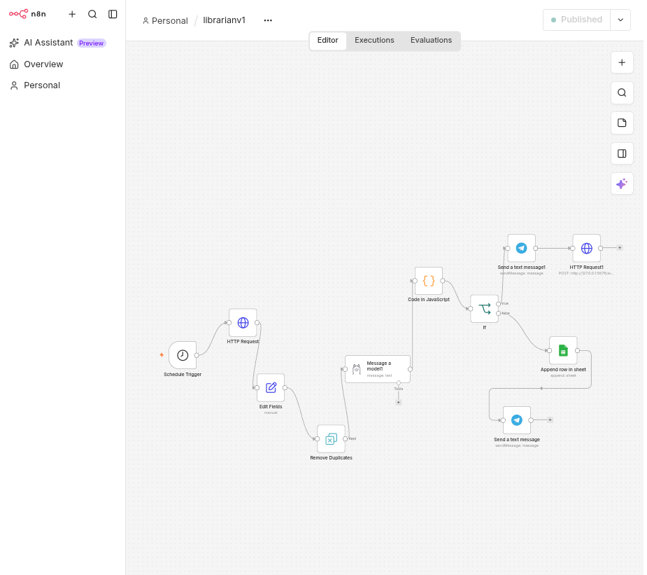
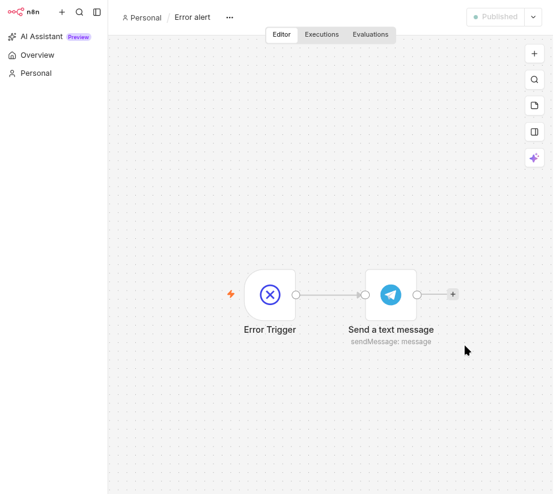
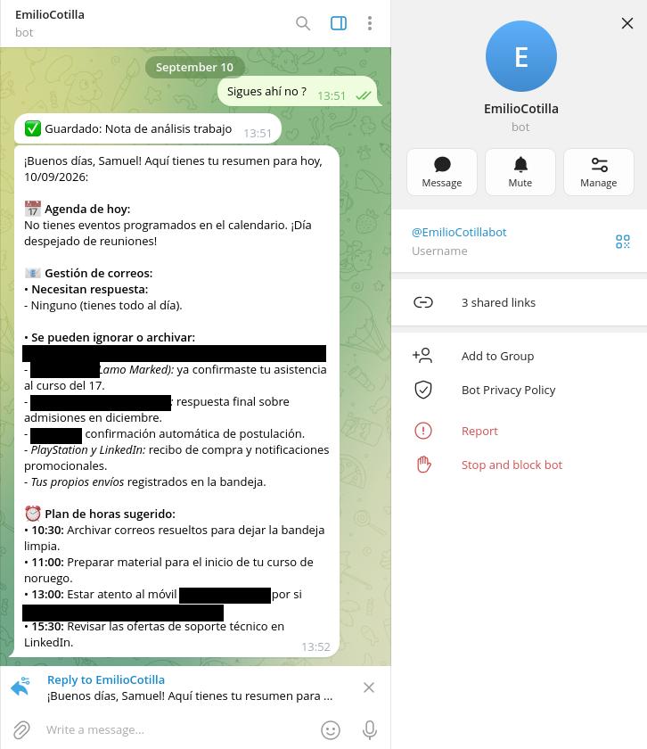

# 🤖 Local AI Agents

A personal assistant built from AI agents that run on my own Linux laptop.
It reads my email and calendar, archives my notes, and sends me three daily
briefings on Telegram — with a voice note in **my own cloned voice**,
generated locally on my GPU.

## 🎯 Why this exists

I was juggling job applications, a Norwegian course and paperwork in three
languages. Instead of checking everything myself, the agents check it for me
and tell me only what matters, three times a day.

## ⚙️ What it does

| Agent | When | What it does |
|-------|------|--------------|
| **CEO** | 08:00 · 14:00 · 21:00, or on demand | Reads Calendar + Gmail, remembers what it already reported, writes a briefing with Gemini, sends text + voice note |
| **Librarian** | Every message I send to the bot | Notes → summarised and tagged by a local LLM, saved to Google Sheets. Questions → triggers the CEO |
| **Voice API** | When the CEO needs audio | Clones my voice with Chatterbox on the GPU and returns a Telegram voice note |
| **Error alert** | When something fails | Sends the failing node and the error to Telegram |

## 🏗️ Architecture



## 🧰 Tech stack

| Layer | Technology |
|-------|------------|
| Orchestration | n8n (Docker, host network) |
| Local LLM | Ollama + llama3.2 (3B) |
| Cloud LLM | Google Gemini Flash |
| Voice cloning | Chatterbox Multilingual · PyTorch + CUDA · FastAPI · ffmpeg |
| Scheduling | systemd timer with RTC wake-up from suspend |
| Integrations | Telegram Bot API · Google Calendar · Gmail · Google Sheets |
| Hardware | RTX 4070 Laptop (8 GB) · 32 GB RAM · Manjaro Linux |

## 🧠 Design decisions

- **Local vs cloud.** Simple classification runs locally (private and free). Reasoning over emails uses Gemini, where a 3B model was not good enough.
- **Rules first, AI second.** The Librarian decides "note or question" with fixed rules and uses the LLM only as a fallback. A small model alone misclassified too often.
- **systemd instead of n8n's scheduler.** Node.js timers do not count time spent in suspend, so a report could arrive hours late. systemd uses real time and can wake the laptop.
- **Memory.** The CEO stores which emails it already reported, so later briefings only detail what is new.
- **Voice on demand.** The voice model needs ~4 GB of VRAM. It loads only when needed and frees the GPU after 5 minutes idle.
- **Secrets outside the workflows.** The bot token lives in a container environment variable and is read with `$env`.

## 🔐 Configuration

**Environment variables (n8n container)**

| Variable | Value |
|----------|-------|
| `TELEGRAM_TOKEN` | From @BotFather |
| `N8N_BLOCK_ENV_ACCESS_IN_NODE` | `false` — lets workflows read the token |
| `GENERIC_TIMEZONE` / `TZ` | `Europe/Oslo` |

**Placeholders to replace in the workflows**

| Placeholder | What to put |
|-------------|-------------|
| `YOUR_TELEGRAM_CHAT_ID` | Your Telegram chat ID |
| `YOUR_EMAIL@gmail.com` | Your Google account |
| `YOUR_SHEET_ID` | The Google Sheet used by the Librarian |

## 🚀 Setup

```bash
docker run -d --name n8n --network host --restart unless-stopped \
  -v ~/n8n_data:/home/node/.n8n \
  -e TELEGRAM_TOKEN='your_bot_token' \
  -e N8N_BLOCK_ENV_ACCESS_IN_NODE=false \
  -e GENERIC_TIMEZONE=Europe/Oslo -e TZ=Europe/Oslo \
  docker.io/n8nio/n8n
```

1. Import the three workflows, replace the placeholders and connect your own Google, Gemini, Telegram and Ollama credentials.
2. Voice API: create a venv, install `torch` (cu126) and `chatterbox-tts`, and add your own reference recording as `mi_voz.wav` (not included — it is biometric data).
3. Copy the files in `systemd/`, then enable `voz-samuel.service` and `ceo-report.timer`.

## 🛠️ Problems solved along the way

| Problem | Fix |
|---------|-----|
| Telegram's HTML mode rejects `<br>` | Sanitise the LLM output before sending |
| `torchaudio.save` requires TorchCodec since 2.9 | Write audio with `soundfile` |
| The laptop woke itself up from `s2idle` | Switched to `deep` sleep |
| The local LLM processed the same message every 5 s | Moved deduplication before the model |
| Renaming an n8n node breaks `$('Node name')` expressions | Rename only with every expression checked |
| Telegram timeouts right after boot | Retry on every node that sends |

## 📁 Project structure

```
ai-agents-local/
├── workflows/     # n8n exports (personal IDs replaced by placeholders)
├── voice-api/
│   └── app.py     # voice cloning API
├── systemd/       # service units, timer and trigger script
└── .gitignore     # keeps audio and secrets out of the repo
```

## 📍 Status & roadmap

**Running daily on my laptop.**

| Done | Item |
|------|------|
| ✅ | Three daily briefings with memory |
| ✅ | Voice notes in my cloned voice |
| ✅ | Notes vs questions classification |
| ✅ | Wake-up from suspend with systemd |
| ✅ | Error alerts on Telegram |
| ⬜ | Conversational CEO (free-form questions) |
| ⬜ | Dedicated Telegram bot for the CEO |
| ⬜ | Automatic call summaries |
| ⬜ | Screenshots and demo video |

## 👤 About

Built by **Samuel Torres Nebro** — moving into AI and cloud development.
Based in Trondheim, Norway.

[LinkedIn](https://www.linkedin.com/in/samuel-torres-0a882b292)

## 📸 Screenshots

**CEO agent — morning report workflow**


**Librarian agent — note capture and classification**


**Error alert workflow**


**A briefing as it arrives on Telegram** (personal data redacted)

