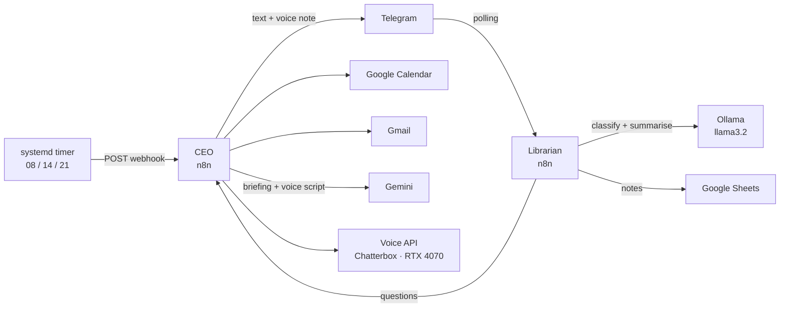

# Local AI Agents — a personal assistant that runs on my laptop

A small "virtual company" of AI agents running on my own Linux laptop. It reads my email and calendar, archives my notes, and sends me three daily briefings on Telegram — **with a voice note in my own cloned voice**, generated locally on my GPU.

## What it does

- **CEO agent** — at 08:00, 14:00 and 21:00 it reads Google Calendar and Gmail, remembers what it already reported, writes a briefing with Gemini and sends text + a voice note to Telegram.
- **Librarian agent** — every message I send to the bot is classified. Notes are summarised and tagged by a local LLM and stored in Google Sheets. Questions trigger the CEO on demand.
- **Voice API** — a FastAPI service around Chatterbox Multilingual (zero-shot voice cloning). Loads the model only when needed, frees the GPU after 5 minutes idle, returns OGG/Opus ready for Telegram.
- **Error alerts** — if the CEO fails, I get a Telegram message with the node and the error.
- **Wake-up** — a systemd timer wakes the laptop from suspend and triggers the CEO.

## Architecture



## Stack

n8n (Docker) · Ollama + llama3.2 · Google Gemini · Chatterbox Multilingual (PyTorch + CUDA) · FastAPI · ffmpeg · systemd · Telegram Bot API · Google Calendar, Gmail and Sheets APIs

## Design decisions

- **Local vs cloud.** Simple classification runs locally on llama3.2 (private and free). Reasoning over emails uses Gemini, where a 3B model was not good enough.
- **Rules first, AI second.** The Librarian decides "note or question" with deterministic rules and uses the LLM only as a fallback. A small model alone misclassified too often.
- **systemd instead of n8n's scheduler.** Node.js timers do not count time spent in suspend, so a scheduled report could arrive hours late. systemd uses wall-clock time and can program the RTC alarm to wake the machine.
- **Memory.** The CEO stores which emails it already reported (workflow static data), so later briefings only detail what is new.
- **Voice on demand.** The voice model needs ~4 GB of VRAM. Loading it only when a briefing is generated leaves the GPU free for Ollama.
- **Secrets outside the workflows.** The bot token is injected as a container environment variable and read with `$env`, so exported workflows contain no credentials.

## Repository layout

```
workflows/   n8n exports (personal IDs replaced by YOUR_... placeholders)
voice-api/   app.py — the voice cloning API
systemd/     service units, timer and trigger script
```

## Setup (short version)

1. Run n8n in Docker:
```bash
   docker run -d --name n8n --network host --restart unless-stopped \
     -v ~/n8n_data:/home/node/.n8n \
     -e TELEGRAM_TOKEN='your_bot_token' \
     -e N8N_BLOCK_ENV_ACCESS_IN_NODE=false \
     -e GENERIC_TIMEZONE=Europe/Oslo -e TZ=Europe/Oslo \
     docker.io/n8nio/n8n
```
2. Import the workflows, replace `YOUR_TELEGRAM_CHAT_ID`, `YOUR_EMAIL` and `YOUR_SHEET_ID`, and connect your own Google, Gemini, Telegram and Ollama credentials.
3. Voice API: create a venv, install `torch` (cu126) and `chatterbox-tts`, and add your own reference recording as `mi_voz.wav` (not included — it is biometric data).
4. Copy the systemd files, then enable `voz-samuel.service` and `ceo-report.timer`.

## Problems solved along the way

- Telegram's HTML mode rejects `<br>` → sanitise the LLM output before sending.
- `torchaudio.save` requires TorchCodec since 2.9 → write audio with `soundfile`.
- The laptop woke itself up in `s2idle` → switched to `deep` sleep.
- The local LLM ran every 5 seconds on the same message → moved deduplication before the model.
- Renaming an n8n node silently breaks every `$('Node name')` expression.
- Telegram requests timing out right after boot → retry on every node that sends.

## Hardware

MSI laptop · i7-13700H · RTX 4070 Laptop (8 GB) · 32 GB RAM · Manjaro Linux (KDE)

## Roadmap

- Conversational CEO: free-form questions with access to calendar and email
- Automatic call summaries
